# Basic workflow overview

!!!- info "Learning outcomes"

    - Learners have created a plot from data
    - Learners heard about the book
      ['R for Data Science'](https://r4ds.hadley.nz/) for things they need

???- question "For teachers"

    Teaching goals are:

    - Learners have experienced the steps on how to create a plot from data

    Prior question:

    - You want to plot data using R. What are the steps to do so?

## Goal

!!! info "Goal of this session"

    The goal of this session is to **experience**
    a full workflow on how to create a plot from data.
    You will remember the steps you did.

    Non-goals are to go into detail what happens **yet**:
    instead, each step is described in more detail in the next sessions.
    
???- question "Prefer a video?"

    [View this session as a YouTube video](https://youtu.be/OwymEQTsks8)

???- question "Could you give an example?"

    From this data ...

    Country  |2000|2015|2030
    ---------|----|----|----
    China    |1270|1376|1416
    India    |1053|1311|1528

    and [some R code](introduction_2.R) to create this figure ...

    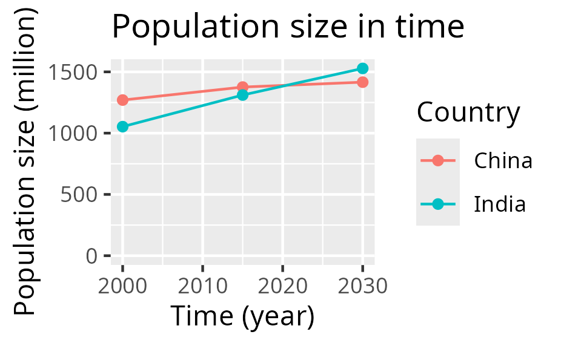

    after which the figure (as an SVG) can be worked upon in other tools.

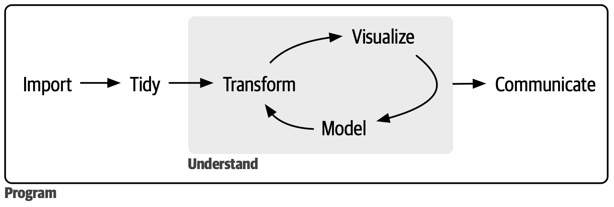

## A typical project visualization

You want to visualize past and predicted
population size by country, using
[the data from the Wikipedia article 'World population'](https://en.wikipedia.org/wiki/World_population)

These are the steps:

- [1. Preparing the data](#1-preparing-the-data)
- [2. Reading the data](#2-reading-the-data)
- [3. Tidying the data](#3-tidying-the-data)
- [4. Cleaning the data](#4-cleaning-the-data)
- [5. Saving the plot](#5-saving-the-plot)
- [6. Refine](#6-refine)

## 1. Preparing the data

You (wisely) decide to start with only a subset of
[the data from the Wikipedia article 'World population'](https://en.wikipedia.org/wiki/World_population):

Country  |2000|2015|2030
---------|----|----|----
China    |1270|1376|1416
India    |1053|1311|1528

From the context, you understand that:

- the columns with numbers (e.g. `2000`) is the years
- the values in the cells are the estimated population size,
  in millions

This data is best saved as a comma-separated (`.csv`) file.

In RStudio, create a new text file: click on 'File | New File | Text File'. 

???- question "Where do I need to click?"

    Click on 'File | New File | Text File':

    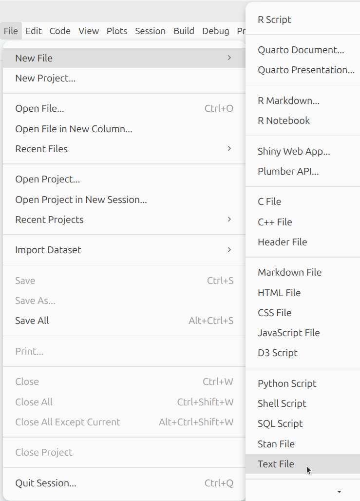

You now have created an empty text file called `Untitled1`.

???- question "What does that look like?"

    Your screen looks similar to this:

    

In this file, paste the data as in the table and use commas as a seperator,
like this.

```text
Country,2000,2015,2030
China,1270,1376,1416
India,1053,1311,1528
```

???- question "What does that look like?"

    Your screen looks similar to this:

    

Save this file by clicking 'File | Save'.

???- question "Where do I need to click?"

    Click on 'File | Save':

    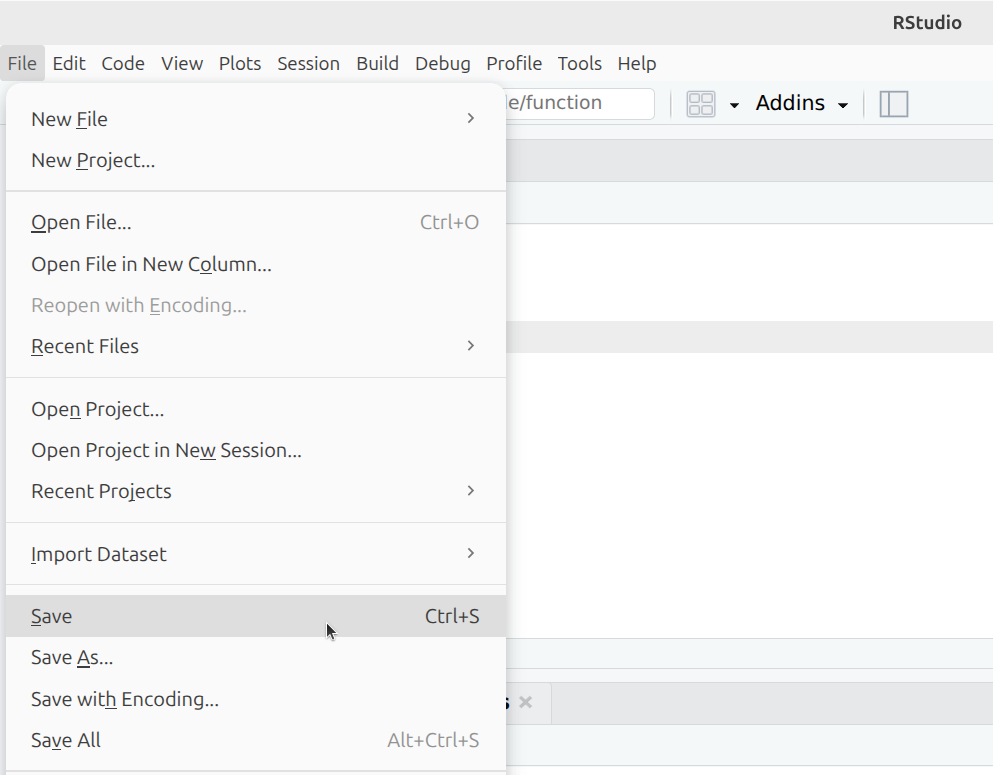

When asked for a name, type `population_sizes.csv` and click 'Save'.

???- question "What does that look like?"

    This -so called- 'Save dialog' depends on your operating system.
    You will recognize it, as it is the same as used by your other programs.

    If you use Ubuntu, your screen looks similar to this:

    

Now you can see in RStudio that your text file is called `population_sizes.csv`.

???- question "What does that look like?"

    Your screen looks similar to this:

    

## 2. Reading the data

To read the data, we create a file that will contain our R code.

Click on 'File | New | R Script'.

???- question "Where do I need to click?"

    Click on 'File | New | R Script':

    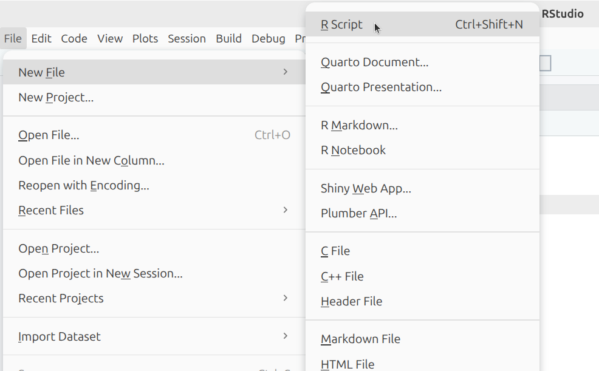

You now have created another empty file called `Untitled1`.

???- question "What does that look like?"

    Your screen looks similar to this:

    

In this file, paste the R code below:

```R
library(readr)
t <- read_csv("population_sizes.csv")
```

???- question "What does that look like?"

    Your screen looks similar to this:

    


Save this file by clicking 'File | Save'.

???- question "Where do I need to click?"

    Click on 'File | Save':

    

When asked for a name, type `create_plot.R` and click 'Save'.

???- question "What does that look like?"

    This -so called- 'Save dialog' depends on your operating system.
    You will recognize it, as it is the same as used by your other programs.

    If you use Ubuntu, your screen looks similar to this:

    

Now you can see in RStudio that your text file is called `create_plot.R`.

???- question "What does that look like?"

    Your screen looks similar to this:

    

You have now created your first R *script*.
A script is a plain-text file with code.

To run the code, put your cursor on the first line and press `ctrl` and `Enter`.

???- question "What does that look like?"

    Your cursor at the first line looks similar to this:

    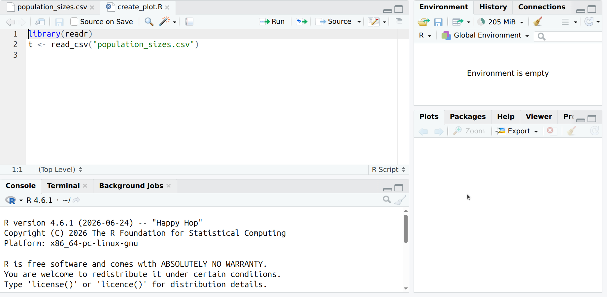

    After pressing `ctrl` and `Enter`, your screen looks similar to this:

    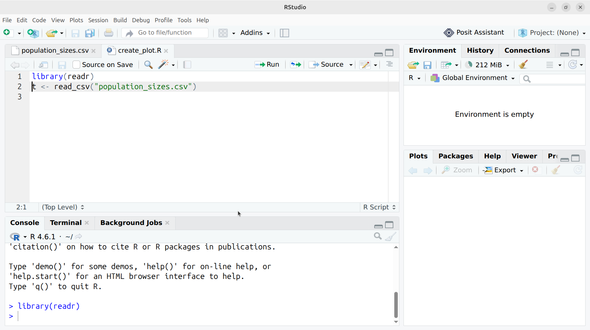

You have just run the code `library(readr)`. This allow you to use code
written by others. In a bit more formal wording:
you have now activated the `readr` library. 

Run the second line too, by pressing `ctrl` and `Enter` again.

???- question "What does that look like?"

    This looks similar to this:

    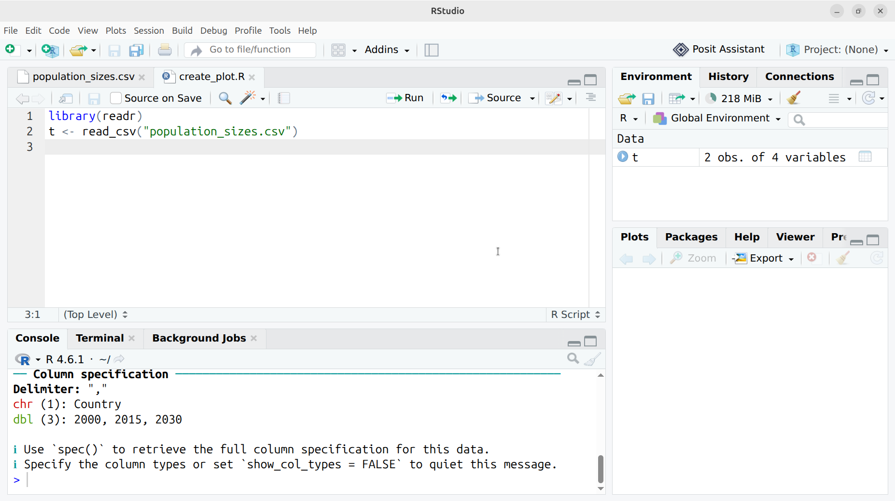

You have now read the file in R. The file is read and turned into
a table you can work on. The table is called `t`.

Reading the data is described in
[Chapter 7: Data Import](https://r4ds.hadley.nz/data-import.html).

Because we use RStudio, we can easily see the data we have loaded in
computer memory: at the right-side of the screen, double-click on `t`.

???- question "Where do I need to click?"

    Double-click on `t` here:

    

You will now see the table called `t`, as well as some summary information

???- question "What does that look like?"

    This looks similar to this:

    

## 3. Tidying the data

The data must be transformed to be tidy, which
[holds these features](https://r4ds.hadley.nz/data-tidy.html#sec-tidy-data):

- Each variable is a column; each column is a variable.
- Each observation is a row; each row is an observation.
- Each value is a cell; each cell is a single value.

Our data is not tidy yet:

|Country | 2000| 2015| 2030|
|:-------|----:|----:|----:|
|China   | 1270| 1376| 1416|
|India   | 1053| 1311| 1528|

Our data is not tidy yet, as we have three observations per row:

- The population in each in the year 2000
- The population in each in the year 2015
- The population in each in the year 2039

In R, we can make this tidy in many ways, for example:

```R
library(tidyr)
t <- t |> pivot_longer(
  cols = c("2000", "2015", "2030")
)
```

Add this code at the end of the `create_plot.R` script and run it.

You can now observe that `t` is tidy like this:

|Country |name | value|
|:-------|:----|-----:|
|China   |2000 |  1270|
|China   |2015 |  1376|
|China   |2030 |  1416|
|India   |2000 |  1053|
|India   |2015 |  1311|
|India   |2030 |  1528|

???- question "Where do I need to click to see `t` again?"

    Double-click on `t` here:

    

Transforming the data is described in:

- [Chapter 3: Data Transformation](https://r4ds.hadley.nz/data-transform.html)
- [Chapter 5: Data Tidying](https://r4ds.hadley.nz/data-tidy.html)

## 4. Cleaning the data

Now we need to do some data transformations:

```r
names(t) <- c("country", "t", "n")
t$country <- as.factor(t$country)
t$t <- as.numeric(t$t)
```

Add this code at the end of the `create_plot.R` script and run it.

???- question "What does that look like?"

    This looks similar to this:

    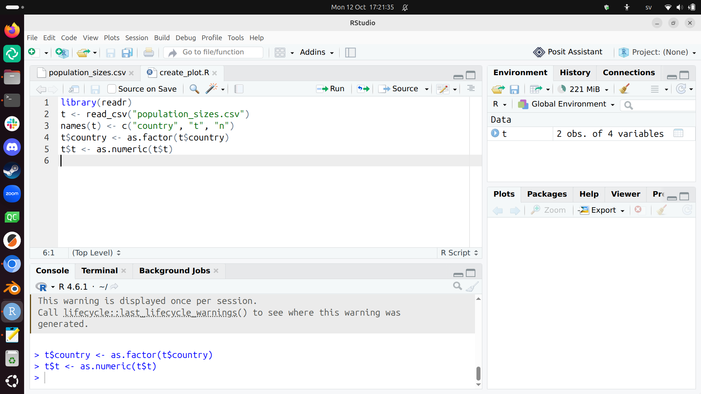

What we have just done:

- We set the column names of `t` to `country` and `t` and `n`
- We set the `country` column to be *categorial*: countries are
  categorical, in this case, either `India` or `China`. 
  The technical term is that a country is a factor.
  Using factors is described in
  [Chapter 16: Factors](https://r4ds.hadley.nz/factors.html)
- We set the `t` column to be *numeric*, as years are numbers

Now the data looks like:

|country |    t|    n|
|:-------|----:|----:|
|China   | 2000| 1270|
|China   | 2015| 1376|
|China   | 2030| 1416|
|India   | 2000| 1053|
|India   | 2015| 1311|
|India   | 2030| 1528|

Plotting this now works:

```r
library(ggplot2)
ggplot(t, aes(x = t, y = n, color = country)) + geom_line()
```

Add this code at the end of the `create_plot.R` script and run it.

???- question "What does that look like?"

    This looks similar to this:

    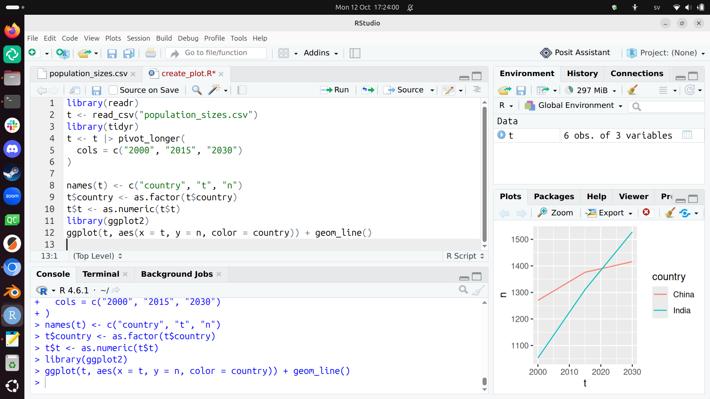

## 5. Saving the plot

After having plotted the plot, it can be saved as such:

```R
ggsave("my_plot.svg")
ggsave("my_plot.png")
```

Add this code at the end of the `create_plot.R` script and run it.

## 6. Refine

The plot looks like this now:

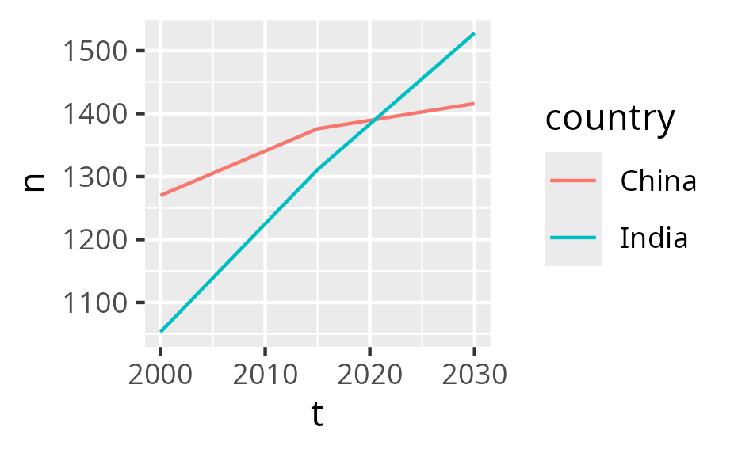

You can refine it in many ways:

- Refine the SVG in another tool
- Refine the generation of the plot

For example, in R:

```R
ggplot(t, aes(x = t, y = n, color = country)) +
  geom_line() +
  geom_point() +
  scale_x_continuous("Time (year)") +
  scale_y_continuous("Population size (million)", limits = c(0, NA)) +
  labs(title = "Population size in time", color = "Country")
```

Add this code at the end of the `create_plot.R` script and run it.

Now the plot has proper labels:


Refining the looks of your plot is described in:

- [Chapter 11: Communication](https://r4ds.hadley.nz/communication.html)

As there is so much to tweak, you definitely need to search the web
and/or use an AI.

## Exercises

## Exercise 1

Do the steps of [the 'A typical project visualization' section](#a-typical-project-visualization)
yourself, by copy-pasting.

Read the chapters if needed and/or search the web and/or use an AI to get what
you need.

## Links

- [`ggplot2` overview of plots](https://r-graph-gallery.com/ggplot2-package.html)
- [`ggplot2` cheat sheet](https://rstudio.github.io/cheatsheets/data-visualization.pdf)
