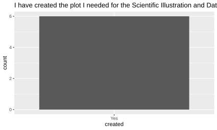

# Evaluation

- [Lesson plan](../../lesson_plans/20261013/README.md)
- [Evaluation](../../evaluations/20261013/README.md)
- [Reflection](../../reflections/20261013/README.md)
- Session: 2
- Date: 2026-10-13

## Results at the end of the day

- [Raw data](CPUG_course_evaluation.csv)
- [Code to create the plot](create_plot.R)

6 out of 6 learners have created a plot.

<!-- markdownlint-disable MD013 --><!-- Use a verbatim copy-paste, hence will break 80 characters per line -->

- A lot of ""I am cool and enthusiastic and flexible and do what you want"" show and a little too little orientation over the course contents / the plan / the to dos -> I found the freedom not engaging but confusing. Please record lectures in the future for 2x option (even though I do understand that the way it is structured now, it does not really make sense to record it, because there is no content to record, but then the label ""lecture"" in the schedule is maybe not the best description of what it is)
- It was a good repetition of R theoretical part, I could work on my own pace. Help was available if needed.
- I had no previous experience in using R and I feel that in just two morning i managed to learn the very basics with plotting a graph. I feel that there should have been at least a small lecture where the teacher was going through the very basics (how your data should look like on excel, or how to save your R script for example). I found these two hours fun and this increased my interest in learning how to use R better
- I think It would be good at the beginning of the course to make a more clear distinction between the experience people have with RStudio, to make it less frustrating for the people who have not tried it before and also make better groupings ind the zoom-rooms. This would make it easier for people to get what they need out of the course and also have better discussions with people on the sample level - to generate ideas for how to display data.
- I have created some kind of plot, but I had to figure most of it out on my own, with the help of AI... It had been very helpful for a beginner like me to have the introduction to R Monday morning (not Tuesday). It had saved me some anxiety at least.
- Richel is a friendly teacher to interact with, which makes the learning much more fun and easy!

<!-- markdownlint-enable MD013 -->

## Results at the end of the course

<!-- markdownlint-disable MD013 --><!-- Tables cannot be split up over lines, hence will break 80 characters per line -->

## Course Evaluation Report: 5642_1 Scientific Illustration and Data

Visualisation (HT26)

## 1. Survey Overview and Participation Metrics

This document synthesizes and formats the complete course evaluation results for
course 5642_1, *Scientific Illustration and Data Visualisation*, delivered
during the autumn term 2026 (HT26) at Karolinska Institutet. The evaluation
assesses curricular structure, instructional effectiveness, skill development,
workload balance, and comparative performance against institutional doctoral
course benchmarks.

| Survey Metric | Value |
| :--- | :--- |
| **Course Code & Title** | 5642_1 Scientific Illustration and Data Visualisation |
| **Evaluation Period** | HT26 (Autumn Semester 2026) |
| **Total Enrolled / Invited Respondents** | 23 |
| **Total Completed Responses** | 14 |
| **Answer Frequency** | 60.87% |

With an answer frequency of 60.87%, the survey provides a robust sample
representing the perspectives of enrolled doctoral candidates.

---

## 2. Quantitative Evaluation: Core Course Dimensions

The survey evaluated fifteen core dimensions using a 5-point Likert scale (*To a
very small extent*, *To a small extent*, *To some extent*, *To a large extent*,
*To a very large extent*), accompanied by descriptive metrics: Mean, Standard
Deviation (SD), Coefficient of Variation (CV), Minimum, Quartiles (Lower
Quartile / Median / Upper Quartile), and Maximum.

### 2.1 Syllabus Transparency, Motivation, and Learning Outcomes

#### Question 1: The content of the course was clearly presented in the syllabus

A total of 85.7% of respondents reported that the syllabus presented course
content clearly to a large or very large extent.

| Response Scale | Number of Responses | Percentage |
| :--- | :--- | :--- |
| To a very small extent | 0 | 0.0% |
| To a small extent | 1 | 7.1% |
| To some extent | 1 | 7.1% |
| To a large extent | 5 | 35.7% |
| To a very large extent | 7 | 50.0% |
| **Total** | **14** | **100.0%** |

*Descriptive Statistics:*

- **Mean:** 4.3 | **Standard Deviation:** 0.9 | **Coefficient of Variation:**
  21.3%
- **Min:** 2.0 | **Lower Quartile:** 4.0 | **Median:** 4.5 | **Upper Quartile:**
  5.0 | **Max:** 5.0

---

#### Question 2: I was highly motivated to learn the content of the course

Student motivation was uniformly high across participants, with 85.7% indicating
strong motivation at the highest levels and no participants reporting small or
very small extent.

| Response Scale | Number of Responses | Percentage |
| :--- | :--- | :--- |
| To a very small extent | 0 | 0.0% |
| To a small extent | 0 | 0.0% |
| To some extent | 2 | 14.3% |
| To a large extent | 5 | 35.7% |
| To a very large extent | 7 | 50.0% |
| **Total** | **14** | **100.0%** |

*Descriptive Statistics:*

- **Mean:** 4.4 | **Standard Deviation:** 0.7 | **Coefficient of Variation:**
  17.1%
- **Min:** 3.0 | **Lower Quartile:** 4.0 | **Median:** 4.5 | **Upper Quartile:**
  5.0 | **Max:** 5.0

---

#### Question 3: The intended learning outcomes of the course were clearly explained

Clarity regarding intended learning outcomes (ILOs) received marked approval,
with 64.3% rating clarity at the maximum level and an overall positive agreement
of 92.9%.

| Response Scale | Number of Responses | Percentage |
| :--- | :--- | :--- |
| To a very small extent | 0 | 0.0% |
| To a small extent | 0 | 0.0% |
| To some extent | 1 | 7.1% |
| To a large extent | 4 | 28.6% |
| To a very large extent | 9 | 64.3% |
| **Total** | **14** | **100.0%** |

*Descriptive Statistics:*

- **Mean:** 4.6 | **Standard Deviation:** 0.6 | **Coefficient of Variation:**
  14.1%
- **Min:** 3.0 | **Lower Quartile:** 4.0 | **Median:** 5.0 | **Upper Quartile:**
  5.0 | **Max:** 5.0

---

### 2.2 Course Architecture, Learning Activities, and Pedagogical Feedback

#### Question 4: The course design facilitated achievement of the intended \

learning outcomes

The pedagogical design was endorsed by 92.9% of students to a large (50.0%) or
very large extent (42.9%).

| Response Scale | Number of Responses | Percentage |
| :--- | :--- | :--- |
| To a very small extent | 0 | 0.0% |
| To a small extent | 0 | 0.0% |
| To some extent | 1 | 7.1% |
| To a large extent | 7 | 50.0% |
| To a very large extent | 6 | 42.9% |
| **Total** | **14** | **100.0%** |

*Descriptive Statistics:*

- **Mean:** 4.4 | **Standard Deviation:** 0.6 | **Coefficient of Variation:**
  14.5%
- **Min:** 3.0 | **Lower Quartile:** 4.0 | **Median:** 4.0 | **Upper Quartile:**
  5.0 | **Max:** 5.0

---

### Question 5: The teaching and learning activities facilitated achievement \

of the intended learning outcomes

Course exercises, practical sessions, and instructional activities supported
learning objectives effectively according to 92.9% of students.

| Response Scale | Number of Responses | Percentage |
| :--- | :--- | :--- |
| To a very small extent | 0 | 0.0% |
| To a small extent | 0 | 0.0% |
| To some extent | 1 | 7.1% |
| To a large extent | 6 | 42.9% |
| To a very large extent | 7 | 50.0% |
| **Total** | **14** | **100.0%** |

*Descriptive Statistics:*

- **Mean:** 4.4 | **Standard Deviation:** 0.6 | **Coefficient of Variation:**
  14.6%
- **Min:** 3.0 | **Lower Quartile:** 4.0 | **Median:** 4.5 | **Upper Quartile:**
  5.0 | **Max:** 5.0

---

### Question 6: During the course, I have received sufficient feedback from

the teachers and/or the other course participants, when needed

Feedback mechanisms received an exceptionally high endorsement, with 57.1% of
students rating feedback at the highest level and 35.7% to a large extent.

| Response Scale | Number of Responses | Percentage |
| :--- | :--- | :--- |
| To a very small extent | 0 | 0.0% |
| To a small extent | 0 | 0.0% |
| To some extent | 1 | 7.1% |
| To a large extent | 5 | 35.7% |
| To a very large extent | 8 | 57.1% |
| **Total** | **14** | **100.0%** |

*Descriptive Statistics:*

- **Mean:** 4.5 | **Standard Deviation:** 0.7 | **Coefficient of Variation:**
  14.5%
- **Min:** 3.0 | **Lower Quartile:** 4.0 | **Median:** 5.0 | **Upper Quartile:**
  5.0 | **Max:** 5.0

---

### 2.3 Student Engagement, Prior Knowledge Heterogeneity, and Faculty

Responsiveness

#### Question 7: I have actively engaged in the course

All respondents (100.0%) reported active participation, divided evenly between
large extent (50.0%) and very large extent (50.0%).

| Response Scale | Number of Responses | Percentage |
| :--- | :--- | :--- |
| To a very small extent | 0 | 0.0% |
| To a small extent | 0 | 0.0% |
| To some extent | 0 | 0.0% |
| To a large extent | 7 | 50.0% |
| To a very large extent | 7 | 50.0% |
| **Total** | **14** | **100.0%** |

*Descriptive Statistics:*

- **Mean:** 4.5 | **Standard Deviation:** 0.5 | **Coefficient of Variation:**
  11.5%
- **Min:** 4.0 | **Lower Quartile:** 4.0 | **Median:** 4.5 | **Upper Quartile:**
  5.0 | **Max:** 5.0

---

#### Question 8: I had sufficient prior knowledge to fully participate in the \

course

Prior knowledge displayed the widest variance in the evaluation, with 21.4%
indicating insufficient background preparation (small or very small extent) and
a coefficient of variation of 34.2%.

| Response Scale | Number of Responses | Percentage |
| :--- | :--- | :--- |
| To a very small extent | 1 | 7.1% |
| To a small extent | 2 | 14.3% |
| To some extent | 2 | 14.3% |
| To a large extent | 6 | 42.9% |
| To a very large extent | 3 | 21.4% |
| **Total** | **14** | **100.0%** |

*Descriptive Statistics:*

- **Mean:** 3.6 | **Standard Deviation:** 1.2 | **Coefficient of Variation:**
  34.2%
- **Min:** 1.0 | **Lower Quartile:** 3.0 | **Median:** 4.0 | **Upper Quartile:**
  4.0 | **Max:** 5.0

---

#### Question 9: During the course, the teachers have been open to students' \

ideas and opinions about the course

Faculty receptivity to student feedback and dialogue was positively assessed by
85.8% of respondents.

| Response Scale | Number of Responses | Percentage |
| :--- | :--- | :--- |
| To a very small extent | 0 | 0.0% |
| To a small extent | 0 | 0.0% |
| To some extent | 2 | 14.3% |
| To a large extent | 6 | 42.9% |
| To a very large extent | 6 | 42.9% |
| **Total** | **14** | **100.0%** |

*Descriptive Statistics:*

- **Mean:** 4.3 | **Standard Deviation:** 0.7 | **Coefficient of Variation:**
  16.9%
- **Min:** 3.0 | **Lower Quartile:** 4.0 | **Median:** 4.0 | **Upper Quartile:**
  5.0 | **Max:** 5.0

---

### 2.4 Practical Skill Mastery, Critical Evaluation, and Assessment Alignment

#### Question 10: During the course, I have developed valuable expertise/skills

Thirteen participants responded to this item, with 100.0% confirming valuable
skill acquisition (53.8% very large extent, 46.2% large extent).

| Response Scale | Number of Responses | Percentage |
| :--- | :--- | :--- |
| To a very small extent | 0 | 0.0% |
| To a small extent | 0 | 0.0% |
| To some extent | 0 | 0.0% |
| To a large extent | 6 | 46.2% |
| To a very large extent | 7 | 53.8% |
| **Total** | **13** | **100.0%** |

*Descriptive Statistics:*

- **Mean:** 4.5 | **Standard Deviation:** 0.5 | **Coefficient of Variation:**
  11.4%
- **Min:** 4.0 | **Lower Quartile:** 4.0 | **Median:** 5.0 | **Upper Quartile:**
  5.0 | **Max:** 5.0

---

#### Question 11: During the course, I have developed my ability to critically \

analyse and evaluate research findings

A majority of respondents (53.8%, n=7) designated this item as *Not applicable*,
reflecting the primary focus on visual communication and software proficiency
rather than research critique. Among the remaining respondents (n=6), responses
were favorable.

| Response Scale | Number of Responses | Percentage |
| :--- | :--- | :--- |
| To a very small extent | 0 | 0.0% |
| To a small extent | 0 | 0.0% |
| To some extent | 1 | 7.7% |
| To a large extent | 2 | 15.4% |
| To a very large extent | 3 | 23.1% |
| *Not applicable* | 7 | 53.8% |
| **Total** | **13** | **100.0%** |

*Descriptive Statistics (Evaluated Responses Only):*

- **Mean:** 4.3 | **Standard Deviation:** 0.8 | **Coefficient of Variation:**
  18.8%
- **Min:** 3.0 | **Lower Quartile:** 4.0 | **Median:** 4.5 | **Upper Quartile:**
  5.0 | **Max:** 5.0

---

#### Question 12: The examination adequately assessed the achievement of the \

intended learning outcomes

The examination framework received unanimous endorsement across participants,
with 100.0% rating alignment at the highest scale levels (57.1% very large
extent, 42.9% large extent).

| Response Scale | Number of Responses | Percentage |
| :--- | :--- | :--- |
| To a very small extent | 0 | 0.0% |
| To a small extent | 0 | 0.0% |
| To some extent | 0 | 0.0% |
| To a large extent | 6 | 42.9% |
| To a very large extent | 8 | 57.1% |
| **Total** | **14** | **100.0%** |

*Descriptive Statistics:*

- **Mean:** 4.6 | **Standard Deviation:** 0.5 | **Coefficient of Variation:**
  11.2%
- **Min:** 4.0 | **Lower Quartile:** 4.0 | **Median:** 5.0 | **Upper Quartile:**
  5.0 | **Max:** 5.0

---

### 2.5 Goal Attainment, Workload Balance, and Overall Course Quality

#### Question 13: I have achieved the intended learning outcomes of the course

Reflecting the assessment results, 92.9% of students indicated successful ILO
attainment.

| Response Scale | Number of Responses | Percentage |
| :--- | :--- | :--- |
| To a very small extent | 0 | 0.0% |
| To a small extent | 0 | 0.0% |
| To some extent | 1 | 7.1% |
| To a large extent | 7 | 50.0% |
| To a very large extent | 6 | 42.9% |
| **Total** | **14** | **100.0%** |

*Descriptive Statistics:*

- **Mean:** 4.4 | **Standard Deviation:** 0.6 | **Coefficient of Variation:**
  14.5%
- **Min:** 3.0 | **Lower Quartile:** 4.0 | **Median:** 4.0 | **Upper Quartile:**
  5.0 | **Max:** 5.0

---

#### Question 14: From my perspective the workload was reasonable in relation \

to the number of credits

Workload was assessed as proportionate by 78.6% of students, while 21.4% felt
proportionality was achieved only to some extent.

| Response Scale | Number of Responses | Percentage |
| :--- | :--- | :--- |
| To a very small extent | 0 | 0.0% |
| To a small extent | 0 | 0.0% |
| To some extent | 3 | 21.4% |
| To a large extent | 7 | 50.0% |
| To a very large extent | 4 | 28.6% |
| **Total** | **14** | **100.0%** |

*Descriptive Statistics:*

- **Mean:** 4.1 | **Standard Deviation:** 0.7 | **Coefficient of Variation:**
  17.9%
- **Min:** 3.0 | **Lower Quartile:** 4.0 | **Median:** 4.0 | **Upper Quartile:**
  4.5 | **Max:** 5.0

---

#### Question 15: This course has fulfilled my expectations of a high quality \

course

Course quality expectations were fulfilled for 92.9% of students to a large
(50.0%) or very large extent (42.9%).

| Response Scale | Number of Responses | Percentage |
| :--- | :--- | :--- |
| To a very small extent | 0 | 0.0% |
| To a small extent | 0 | 0.0% |
| To some extent | 1 | 7.1% |
| To a large extent | 7 | 50.0% |
| To a very large extent | 6 | 42.9% |
| **Total** | **14** | **100.0%** |

*Descriptive Statistics:*

- **Mean:** 4.4 | **Standard Deviation:** 0.6 | **Coefficient of Variation:**
  14.5%
- **Min:** 3.0 | **Lower Quartile:** 4.0 | **Median:** 4.0 | **Upper Quartile:**
  5.0 | **Max:** 5.0

---

## 3. Doctoral Student Recommendation Rate

### Question 18: Would you recommend this course to others enrolled in \

doctoral education?

Student endorsement was unanimous: 100.0% of doctoral candidates (14 of 14)
recommended the course to peers, with no negative responses or non-applicable
designations.

| Response Scale | Number of Responses | Percentage |
| :--- | :--- | :--- |
| Yes | 14 | 100.0% |
| No | 0 | 0.0% |
| *Not applicable* | 0 | 0.0% |
| **Total** | **14** | **100.0%** |

*Descriptive Statistics:*

- **Mean:** 1.0 | **Standard Deviation:** 0.0 | **Coefficient of Variation:**
  0.0%
- **Min:** 1.0 | **Lower Quartile:** 1.0 | **Median:** 1.0 | **Upper Quartile:**
  1.0 | **Max:** 1.0

---

## 4. Benchmark Comparison with Karolinska Institutet Doctoral Courses (2025 \

Aggregated)

The performance of course 5642_1 is evaluated against the aggregated benchmark
comprising all doctoral education courses evaluated across Karolinska Institutet
during calendar year 2025.

### Comprehensive Benchmark Matrix

| Dimension / Survey Question | Course Mean | Aggregated KI Mean | Difference of Means | Course Median | Aggregated KI Median | Course P25 | Aggregated KI P25 | Course P75 | Aggregated KI P75 |
| :--- | :--- | :--- | :--- | :--- | :--- | :--- | :--- | :--- | :--- |
| **Q1 Course content** | 4.29 | 4.41 | -0.12 | 4.50 | 5.00 | 4.00 | 4.00 | 5.00 | 5.00 |
| **Q2 Motivation** | 4.36 | 4.39 | -0.03 | 4.50 | 5.00 | 4.00 | 4.00 | 5.00 | 5.00 |
| **Q3 Clear ILOs** | 4.57 | 4.35 | **+0.23** | 5.00 | 4.00 | 4.00 | 4.00 | 5.00 | 5.00 |
| **Q4 Course design** | 4.36 | 4.26 | **+0.10** | 4.00 | 4.00 | 4.00 | 4.00 | 5.00 | 5.00 |
| **Q5 Teaching activities** | 4.43 | 4.27 | **+0.16** | 4.50 | 4.00 | 4.00 | 4.00 | 5.00 | 5.00 |
| **Q6 Feedback** | 4.50 | 4.22 | **+0.28** | 5.00 | 4.00 | 4.00 | 4.00 | 5.00 | 5.00 |
| **Q7 Engagement** | 4.50 | 4.37 | **+0.13** | 4.50 | 5.00 | 4.00 | 4.00 | 5.00 | 5.00 |
| **Q8 Prior knowledge** | 3.57 | 3.96 | **-0.39** | 4.00 | 4.00 | 3.00 | 3.00 | 4.00 | 5.00 |
| **Q9 Student input** | 4.29 | 4.43 | -0.14 | 4.00 | 5.00 | 4.00 | 4.00 | 5.00 | 5.00 |
| **Q10 Expertise/skills** | 4.54 | 4.23 | **+0.31** | 5.00 | 4.00 | 4.00 | 4.00 | 5.00 | 5.00 |
| **Q11 Critical analysis** | 4.33 | 4.16 | **+0.17** | 4.50 | 4.00 | 4.00 | 4.00 | 5.00 | 5.00 |
| **Q12 Examination** | 4.57 | 4.28 | **+0.29** | 5.00 | 4.00 | 4.00 | 4.00 | 5.00 | 5.00 |
| **Q13 Achieved ILOs** | 4.36 | 4.22 | **+0.14** | 4.00 | 4.00 | 4.00 | 4.00 | 5.00 | 5.00 |
| **Q14 Workload** | 4.07 | 4.14 | -0.07 | 4.00 | 4.00 | 4.00 | 4.00 | 4.50 | 5.00 |
| **Q15 Fulfilled expectations** | 4.36 | 4.28 | **+0.08** | 4.00 | 5.00 | 4.00 | 4.00 | 5.00 | 5.00 |

---

## 5. Qualitative Feedback: Identified Areas of Excellence

In Question 16 (*"Were there any parts of the course that were excellent? If so,
please specify which parts and in what way."*), participants provided detailed
praise regarding pedagogical structure, applied project work, feedback loops,
and instructional delivery.

### 5. Verbatim Student Submissions

- *"I really like the part that there's an the time slot to freely work on our
  own project and get feedback from it. Also the part where examples of good
  illustrations were used to explain the concept and process of design."*
- *"Great course and competent teachers."*
- *"Having a journal was very useful to follow up the progress one has made
  during the course."*
- *"The possibility to receive feedback, make improvements, and receive feedback
  again was also very appreciated."*
- *"Hands-on training on the design softwares was very high quality and easy to
  follow. In general the first week of classes was all top notch. Overall the
  best course I took during my whole PhD!"*
- *"I think having the journal to stay accountable and on top of assignments was
  good. All of Meike's lectures were super informative and useful."*
- *"Friendly environment and very interesting lectures."*
- *"Learning how to make graphic abstract using affinity"*
- *"Meike Latz's parts were well thought through, utilized great methodological
  diversity matching the each topic, very well structured. Engaging. Flexible.
  One of the best online courses I had in a long time."*
- *"Overall i really enjoyed this course! I loved the freedom to do figures and
  the time to also work on it by my self by still be able to seek help if
  needed. And really beneficial to get feedback from other people not in my
  field, to see where the figures might have been to complicated or to
  confusing."*
- *"This was among the best courses that I have participated in. Very clear
  structure, great teacher, very interactive and I learned a lot. The lectures
  were well structured and provided a lot of opportunity to be implemented in my
  later career (even if its not academia). I would recommend this as a mandatory
  course for every PhD Student."*

---

## 6. Qualitative Feedback: Constructive Critiques and Pedagogical \

Recommendations

In Question 17 (*"Do you have any recommendations as to how the course could be
improved? If so, please specify which parts and how."*), students submitted
targeted suggestions concerning prerequisite communication, R/RStudio
instruction, workload allocation, and delivery modality.

### 6. Verbatim Student Submissions

- *"Not really, keep it as it is. This was the first KI course I recommend to
  other PhD students."*
- *"I think it would be great if during week to the students were divided into
  groups of who have experience with Rstudio and who do not have. Because as
  somebody with experience I used a lot of time on helping with the basics and I
  think that because I was not prepared for this I did not know how to do it
  properly - to lessen the students in my groups frustration of learning a
  completly new program. So I could have used my time better by talking and
  developing ideas for my data visualization if I had been in a group where
  people have experience and the one i 'helped' could have learned it better if
  they had gotten a structured teaching on Rstudio."*
- *"The R session was very confusing and disorienting. Working with a book does
  not need to happen in breakout rooms. Very irritating teaching style in terms
  of the way we were spoken to, in my opinion."*
- *"I personally find that the homework needs more than the planned time,
  especially to get use to a new software. It could have been a bit more credit
  hours."*
- *"Richel Bilderbeek was not the perfect teacher for a total beginner in R! I
  would have wanted some introduction and some tips and tricks how to at least
  get started. (He did not teach med R, AI did.)"*
- *"The description could be a little bit more clear. I misinterpreted it
  somewhat. Quite overwhelming for someone who has never worked with vector
  programs or R before."*
- *"It might be better to have the possibility to have education IRL during the
  practical sessions. Difficult to get help online."*
- *"They should allow the use of elements from Biolender"*
- *"The DataVis practice on the Wednesday of the 2nd week felt very repetitive,
  especially the group parts in breakout rooms, after we had talked a lot about
  data visualisation. Maybe it should be earlier in the course. I also didn't
  find the lectures on Thursday very useful, there wasn't much tangible
  information in there, more like 'hey be aware those things exist and look into
  them'."*
- *"I also would suggest making people plot the same data for the 2 data
  visualisations, it makes it more interesting to compare how to communicate in
  scientific publications and to a general audience."*
- *"Even though graphical design skill were not required, it would be good to
  mention it in the syllabus. It was a bit stressful in the beginning."*
- *"Maybe the R software part could be a bit more redesigned / flexible to
  include multiple softwares for those who are not using R frequently."*
- *"Would be nice to add a section on which graphs / visuals can work better to
  convey the message and impacts for different types of data."*

<!-- markdownlint-enable MD013 -->
