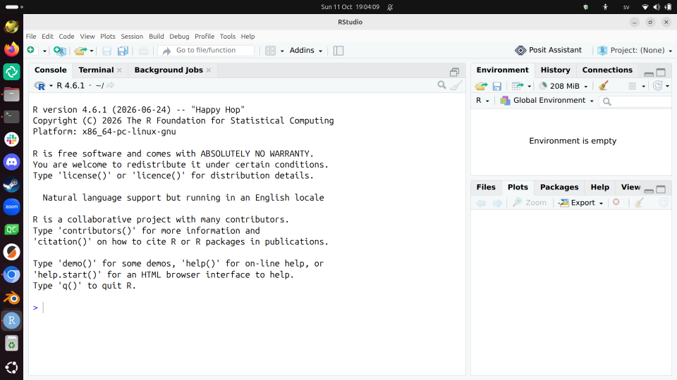

# Install RStudio

!!!- info "Learning outcomes"

    - Install RStudio

???- question "For teachers"

    Teaching goals are:

    - Learners have installed RStudio

    Questions:

    - Why use RStudio?

## Goals

- Install RStudio
- Minimal use of RStudio

## What is RStudio

RStudio is a program to help you program in R.

## Why use RStudio?

RStudio is:

- one of the most used programming environments for R
- free and open source
- helpful to beginners

## Exercises

## Exercise 1: install RStudio

- Search the web for 'Install RStudio'
- Click on the hit
  [Download RStudio Desktop and Server | Posit Data Science Tools](https://posit.co/downloads)
- On that page, click 'Download RStudio'
- Download the (Open Source) RStudio version
  that is suitable for your operating system
