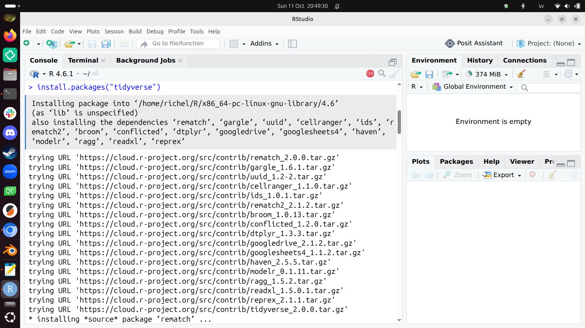
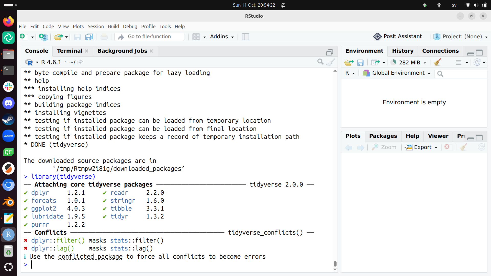

# Install RStudio and the Tidyverse packages

!!!- info "Learning outcomes"

    - Install RStudio and the Tidyverse packages

???- question "For teachers"

    Teaching goals are:

    - Learners have installed RStudio and the Tidyverse packages

    Questions:

    - Why use RStudio?
    - Why use the Tidyverse?

## Goals

- Install RStudio
- Using RStudio to install the Tidyverse packages

## What is RStudio?

RStudio is a program to help you program in R.

## Why use RStudio?

RStudio is:

- one of the most used programming environments for R
- free and open source
- helpful to beginners

## Exercises

## Exercise 1: install RStudio

- Search the web for 'Install RStudio'
- Click on the hit
  [Download RStudio Desktop and Server | Posit Data Science Tools](https://posit.co/downloads)
- On that page, click 'Download RStudio'
- Download the (Open Source) RStudio version
  that is suitable for your operating system
- Run the RStudio installer. Use all defaults.

## Exercise 2: install the `tidyverse` packages

Follow the instructions at
[section 'The `tidyverse`'](https://r4ds.hadley.nz/intro.html#the-tidyverse)
to install the Tidyverse packages

???- question "How does that look like?"

    

This can take a while and this is a great moment to already scan
[the book 'R for data scientists'](https://r4ds.hadley.nz/).

## Exercise 3: activate the `tidyverse` packages

Follow the instructions at
[section 'The `tidyverse`'](https://r4ds.hadley.nz/intro.html#the-tidyverse)
to activate the Tidyverse packages.

???- question "How does that look like?"

    
