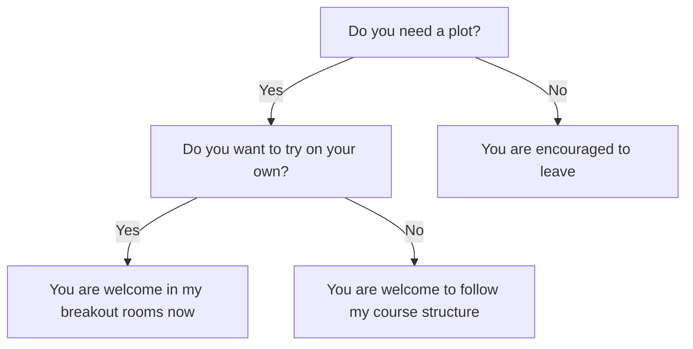
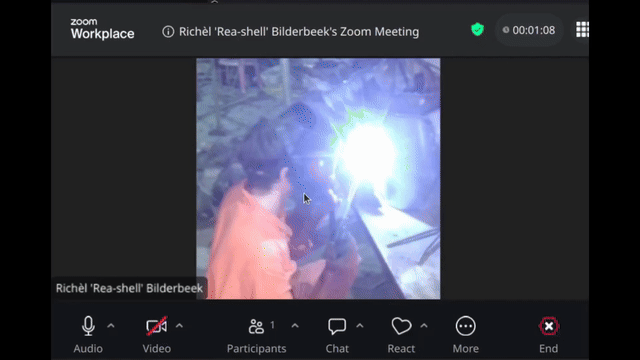
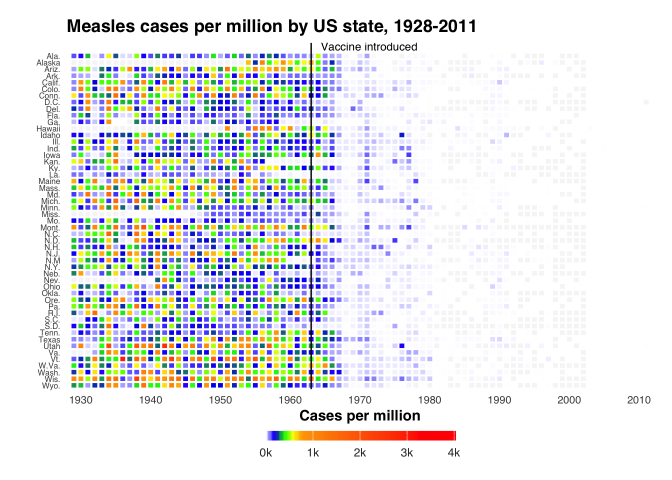
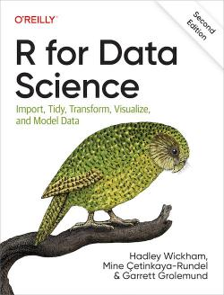

# Introduction

!!!- info "Learning outcomes"

    - Understand the goal of the course

???- question "For teachers"

    Teaching goals are:

    - Learners have heard to goal of the course

    Questions at start:

    - What is R?
    - Why use R for plotting?
    - What is `ggplot2`?
    - Why use `ggplot2` for plotting?
    - What is RStudio?
    - Why use RStudio?

    Questions at end:

    - Is it OK to work in Python?
    - Is it OK to use AI?
    - Is it OK to use other R libraries for plotting?
    - Is it OK to skip chapters you already know?
    - Is it OK to leave early?

## Goal of this course

!!! note "The goals of this course"

    Create a plot needed for the
    Scientific Illustration and Data Visualisation course.

This course is optional.

## This course setup

- This workshop is aimed at learners from any initial skill level.
- We use R: this seems to be most common in this course
- We use R's `ggplot2` library:
  this is the most used plotting library in R and it is very tunable
- We use [a free book](https://r4ds.hadley.nz/),
  so that you **can** learn R and `ggplot2`
- We use breakout rooms, so we can talk in small groups
- You can work alone or in a group of two/three
- Breaks are sacred, the schedule is not
  Advanced learners will likely finish earlier.
  Beginner learners will get the extra time and help they need.
- You are encouraged to leave when you are done
  and having filled in
  [the course evaluation](https://richelbilderbeek.github.io/create_plot_using_ggplot2_course/evaluation/).
  Do say bye: it is the human thing to do
- You can always
  [leave feedback anonymously](https://richelbilderbeek.github.io/create_plot_using_ggplot2_course/evaluation/)
  that will be published: this helps improve the course

Sometimes I will ask for a 'Yes' or 'No' reaction. Here is where you
can find these in Zoom:

## Why use R?

- R is a Turning-complete programming language
- R is **widely used**: it is
  [among the top 10 most used programming languages](https://www.tiobe.com/tiobe-index/)
  and probably among the top 2 of programming langauges used in academia
- R is a **free and open-source** language
- R works on **all major operating systems**
- R has **many packages**: a package is a body of code written by others
  that you can use easily.
  Currently, there are
  [around 25,000 general packages](https://cran.r-project.org/web/packages/index.html)
  and
  [around 2,000 packages specialized for the life sciences](https://www.bioconductor.org/).
  Whatever you are looking for, R probably has a package for just that!

## Why use `ggplot2`?

- `ggplot2` is an R package for plotting
- `ggplot2` is **widely used**: it is among
  [the top 100 most downloaded R packages](https://r-packages.io/top-packages)
- `ggplot2` has **the most commonly used plots available**, e.g. those
  [showcased in this gallery](https://r-graph-gallery.com/ggplot2-package.html)
- `ggplot2` has **many extensions** to plot even more, e.g. those
  [showcased in this gallery](https://exts.ggplot2.tidyverse.org/gallery/)
- `ggplot2` uses a **grammar of graphics**, which allows you to express
  your plotting needs in code
- `ggplot2` can create publication-ready plots: you will start recognizing
  them :-)

## Why use the book 'R for Data Scientists'?

- [The book 'R for Data Scientists'](https://r4ds.hadley.nz/) is about
  using R and `ggplot2` to visualize data
- The book is **free and open access**
- The book is both **digital and in paper**
- The book follows **best practices**, e.g. the Tidyverse approach
