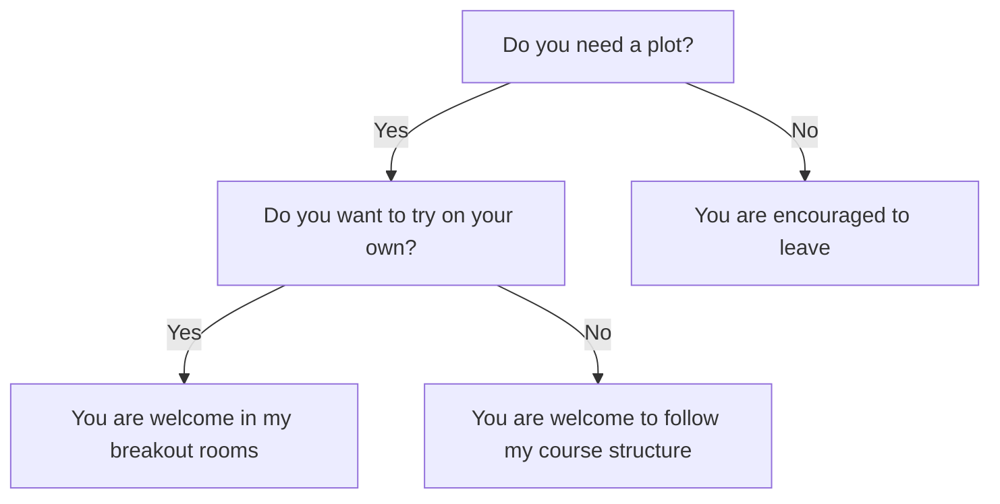

# Introduction

!!!- info "Learning outcomes"

    - Understand the goal of the course

???- question "For teachers"

    Teaching goals are:

    - Learners have heard to goal of the course

## Goal of this course

Create a plot needed for the
Scientific Illustration and Data Visualisation course.

