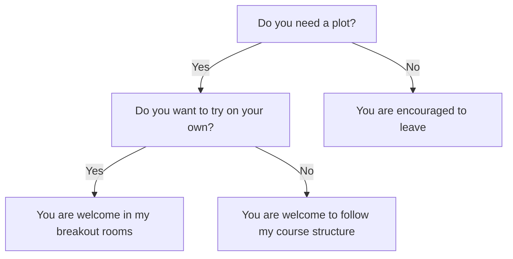
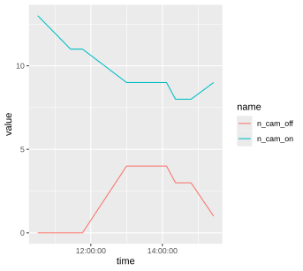

# Introduction

!!!- info "Learning outcomes"

    - Understand the goal of the course

???- question "For teachers"

    Teaching goals are:

    - Learners have heard to goal of the course

## Goal of this course

Create a plot needed for the
Scientific Illustration and Data Visualisation course.



## Example

This is the file with data:

```text
time,n_cam_on,n_cam_off
10:31,13,0
11:26,11,0
11:40,11,0
11:46,11,0
13:00,9,4
14:07,9,4
14:22,8,3
14:48,8,3
15:26,9,1
```

Here is [an R script](create_plot.R) to create a scalable vector graphic:

```r
library(readr)
t_wide <- read_csv("20240419_counts.csv")
library(tidyr)
t_tidy <- t_wide |> tidyr::pivot_longer(cols = c(n_cam_on, n_cam_off))
library(ggplot2)
ggplot(t_tidy, aes(x = time, y = value, color = name)) + geom_line()
ggsave(filename = "my_plot.svg")
```

Here is the scalable vector graphics


