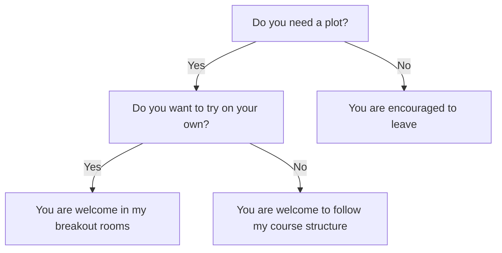

# Introduction

!!!- info "Learning outcomes"

    - Understand the goal of the course

???- question "For teachers"

    Teaching goals are:

    - Learners have heard to goal of the course

    Questions:

    - What is R?
    - Why use R for plotting?
    - What is `ggplot2`?
    - Why use `ggplot2` for plotting?
    - What is RStudio?
    - Why use RStudio?

## Goal of this course

!!! note "The goal of this course"

    Create a plot needed for the
    Scientific Illustration and Data Visualisation course.

This course is optional.

## This course setup

- We use R: this seems to be most common in this course
- We use R's `ggplot2` library:
  this is the most used plotting library in R and it is very tunable
- We use [a free book](https://r4ds.hadley.nz/),
  so that you **can** learn R and `ggplot2`
- We use breakout rooms, so we can talk in small groups
- You can work alone or in a group of two/three
- Breaks are sacred, the schedule is not
- You are encouraged to leave when you are done
  (do say bye: it is the human thing to do)
- You can always
  [leave feedback anonymously](https://richelbilderbeek.github.io/create_plot_using_ggplot2_course/evaluation/)
  that will be published: this helps improve the course

